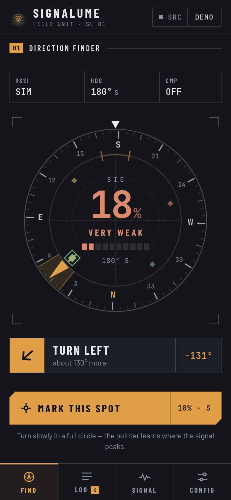
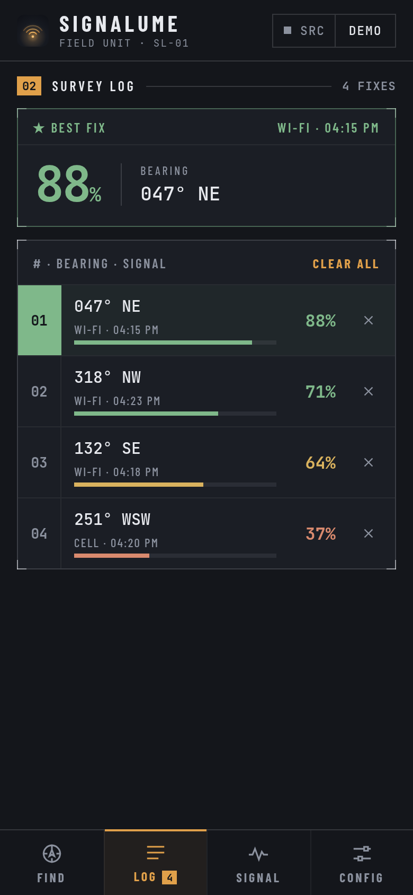
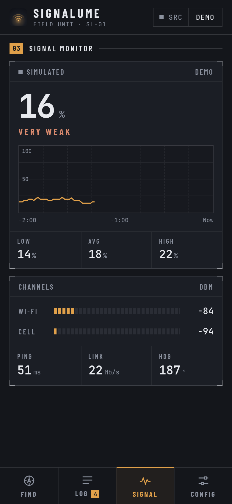
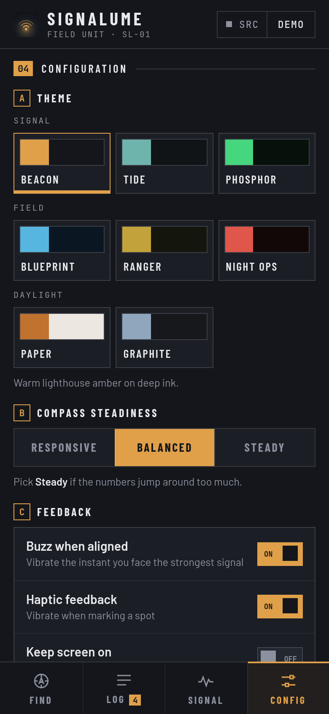
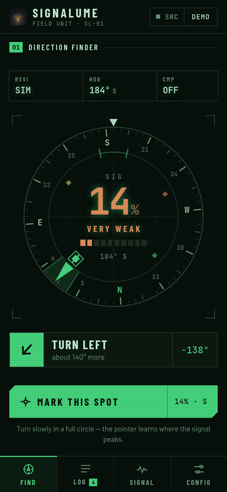
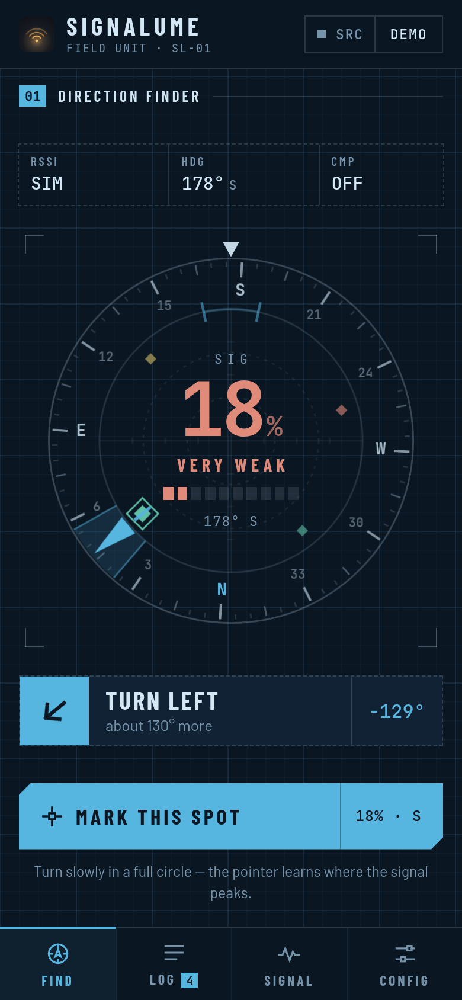
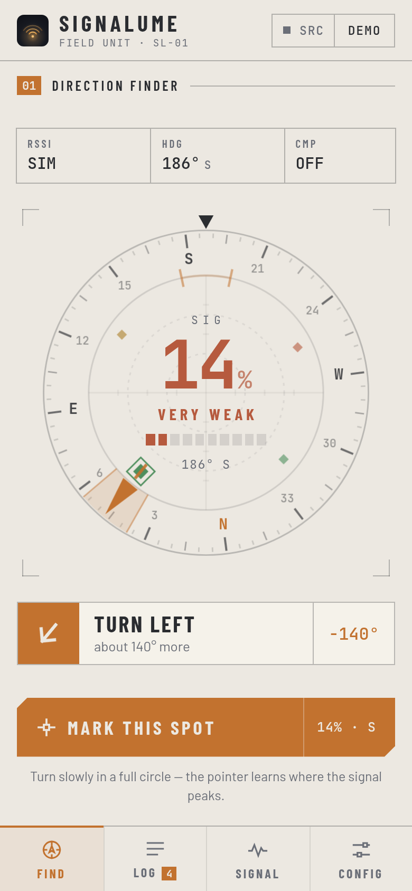

<p align="center">
  
</p>

<h1 align="center">SIGNALUME</h1>

<p align="center">
  <b>A directional signal finder for Android.</b><br/>
  Turn slowly in a circle — the dial learns where the signal peaks and points you to it.
</p>

<p align="center">
  
  
  
  
</p>

---

## What it does

Signalume answers one question: **which way is the signal strongest, and where should I stand?**
Useful for placing a router, picking a seat in a café, or finding the one corner of a room
where mobile data actually works.

| Screen | What it shows |
| --- | --- |
| **01 · Find** | Compass dial with a fixed lubber mark at the top and a wedge pointing at the strongest direction measured so far. Turn until it reads **LOCKED ON**. |
| **02 · Log** | Every spot you mark, ranked strongest-first, with bearing, source (Wi-Fi / Cell) and time. The best fix gets a ★. |
| **03 · Signal** | Live strength, a two-minute trace, low / avg / high, Wi-Fi and cellular dBm, ping and link rate. |
| **04 · Config** | 8 themes, compass smoothing, haptics, keep-awake and dial overlays. |

## Honest readouts

On Android **every number is measured**, and anything that can't be measured shows `--`:

- **Heading:** phone magnetometer.
- **Wi-Fi RSSI and link rate:** `WifiManager` over JNI ([`src-tauri/src/lib.rs`](src-tauri/src/lib.rs)).
- **Cellular dBm:** `TelephonyManager`, used when there's no Wi-Fi. Needs the Location permission (an Android rule).
- **Ping:** a real TCP handshake round-trip, sampled every few seconds.

With no signal source at all, the app says so and waits. It never invents a reading. Only the
desktop/browser preview uses a simulated field, and it's labelled **DEMO** everywhere.

## Themes

Eight field-instrument palettes. Some have their own character: Phosphor gets CRT glow and
scanlines, and Blueprint gets a drafting grid with dashed rules.

<p align="center">
  
  
  
</p>

`Beacon` · `Tide` · `Phosphor` · `Blueprint` · `Ranger` · `Night Ops` · `Paper` · `Graphite`

## Tech stack

- [SvelteKit](https://svelte.dev/) (Svelte 5), built as a static SPA with `@sveltejs/adapter-static`
- [Tauri v2](https://v2.tauri.app/) for the Android target, with native signal reading in Rust over JNI
- TypeScript + Vite, with Barlow, Barlow Condensed and JetBrains Mono bundled via Fontsource (works offline)

> The app is a **static SPA** (`ssr = false`, `prerender = true`) because the Tauri WebView has
> no Node.js server. It serves prebuilt files from `tauri.localhost`.

## Development

```bash
npm install
npm run dev        # browser preview (demo signal)
npm run build      # static frontend → build/
```

### Android (standalone APK)

```bash
npm run build
rm -rf src-tauri/gen/android/app/src/main/assets/_app
cp -r build/. src-tauri/gen/android/app/src/main/assets/
JAVA_HOME=/usr/lib/jvm/java-17-openjdk npx tauri android build --apk --target aarch64

# align + sign so it installs outside the Play Store
BT=~/Android/Sdk/build-tools/36.1.0
$BT/zipalign -p -f 4 src-tauri/gen/android/app/build/outputs/apk/universal/release/app-universal-release-unsigned.apk apk/aligned.apk
$BT/apksigner sign --ks ~/.android/debug.keystore --ks-pass pass:android \
  --ks-key-alias androiddebugkey --out apk/signalume.apk apk/aligned.apk
```

Notes:

- `tauri.conf.json` must **not** have a `devUrl`, or the APK tries to reach a dev server.
- `build.gradle.kts` overrides `ignoreAssetsPattern`, because AAPT2 drops SvelteKit's `_app/` folder by default.

## License

MIT
